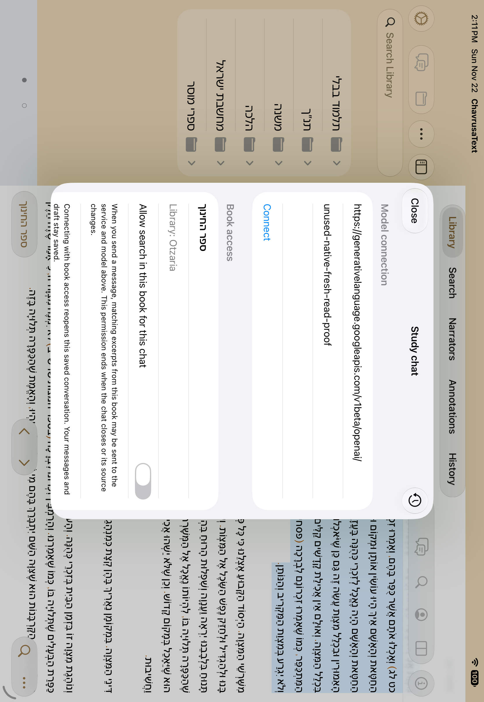

# Original fresh-read diagnostic — run 45028340249

The exact selected XCTest executed once and failed: **0 PASS / 1 FAIL / 0 SKIP / 0 NOT_RUN**. It ran on source6736f7a1, whose app/UI source closure is d49cedb3. This precedes the separate StageB consumer source now on the canonical continuation branch.

The app and UI runner built successfully. The unchanged Host48 result was independently reused with zero new executions. All compiled code images stayed unchanged during this run. The matching disposable compiler cache was saved, and owned simulator cleanup passed.

## Actual failure

At HanlinConsumerAcceptanceTests.swift:333 the book-consent row still reported0 after one tap on its actual contained native switch. The real system keyboard had disappeared; the child was enabled, hittable and inside the exact identified row. Both row and child remained0 in the final hierarchy. The before/after screenshots have identical bytes (SHA25657fe2065609775c6e15036da3f49c9d4fb3f11b3e1694490db460680252ddb3d).

Connect was not reached. No Live key or Send action was used. This run cannot qualify the fresh read connection, native product, StageB, Live or Release.

The original synthesized event records a physical touch at(246.5,829.5); with the recorded landscape window1210x834 this maps to the visible switch centre(829.5,587.5). The mapping is an inference and does not establish why the native tap failed. Source review found no explicit consent-reset handler. A normal one-thumb-drag diagnostic is being prepared with every original acceptance condition retained.

## Preserved evidence

[RUN.json](RUN.json) records exact artifact hashes, counts, cleanup, observer and binary identities. The complete6,472,097-byte evidence ZIP is retained in Git, together with the three full original hierarchies, original native touch event and unchanged final screenshot. The full105,486,557-byte capture ZIP, including the original xcresult and movies, remains at the owned Sentinel path recorded in RUN.json. Both archives were downloaded exactly once and passed SHA256 and ZIP CRC verification.

The original raw collector field named missing includes nonpassing selections; the actual collector result explicitly reports ui_not_run=0. The independent xcresult and raw test log establish that the one failed case really executed.

