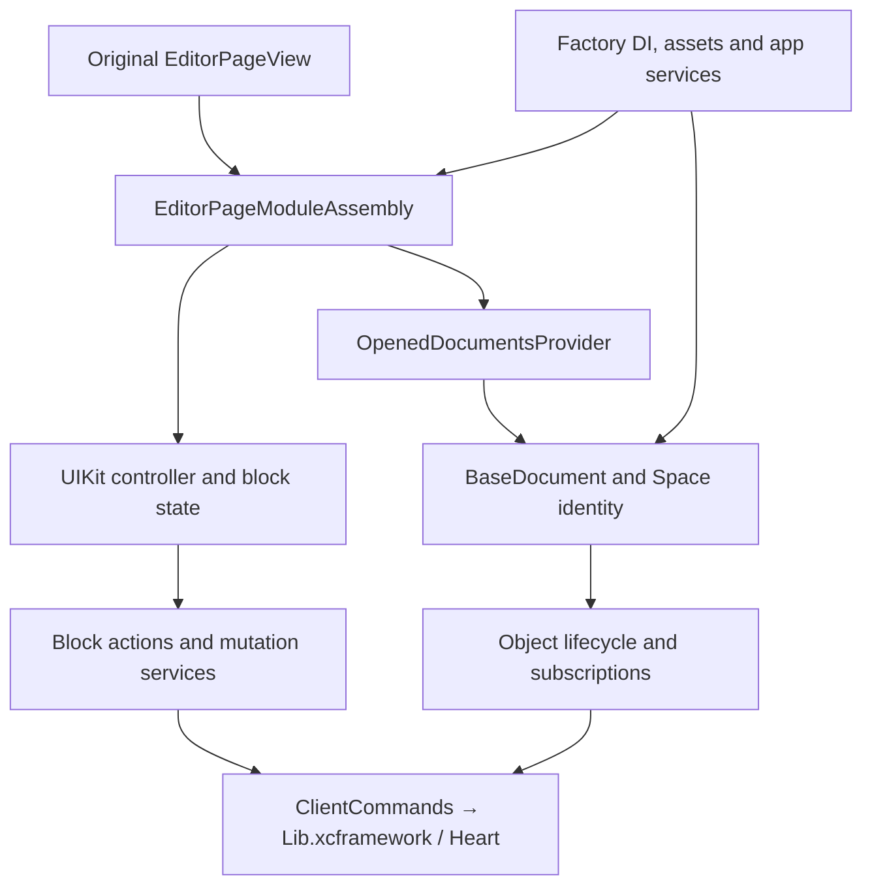

# CROSS-APP Stage A — original Anytype editor and annotation exchange

Date: 2026-11-20. Scope: [CROSS-APP task 1220545194715722][crossapp], Stage A audit, architecture decision and bounded source feasibility spike. **Stage A source research is complete; the original editor has not been embedded, compiled or exercised in Otzaria by this work. Stages B–F and the overall task remain open.**

## Decision

Prefer a versioned module containing the **original Anytype editor**, with a deliberately extracted document/mutation boundary and an Otzaria annotation adapter. Do not copy `EditorPageView` into the consumer: its assembly opens a real Anytype object in a Space and its block operations reach the native runtime. The source audit demonstrates that the desired adapter boundary does not already exist. Extraction feasibility still requires an actual Apple build and the two-block, same-annotation POC below. If preserving the original editor requires its complete document/runtime contract, evaluate the second option—an isolated embedded original runtime—openly, including its different storage ownership.

The current user continuation supersedes the November 15 planning-only/owner-pause wording. That authorization does not constitute editor, sync, signing or license acceptance. This isolated branch changes documentation and the audit script only; it does not change either application's product source, dependencies, signing or data. Existing native BooksUpdates results were not rerun or counted toward this feature.

## 1. Exact sources and preservation

| Source | Inspected identity | Meaning |
|---|---|---|
| Requested Anytype checkout | `C:\Users\DAVID\Code\anytype-swift`, HEAD `8494cfb3479e7768c450e1d668279456b95ca965` | Existing dirty checkout, 48 status entries; preserved. It is not the latest published T5 source. |
| Published original-app source | [`a05088b98844bba30f90b794effb8cf579e2ef08`][anyroot], branch `codex/chatgpt-wave15-ui-resume-20261119` | `origin` branch SHA verified with `ls-remote`; inspected through immutable local Git blobs without checkout/fetch. |
| Upstream Anytype | `anyproto/anytype-swift`, observed develop `d857b23ea540be33d6faab4f7a7a1a260ab578c1` | Provenance reference; no upstream merge or import. |
| Otzaria/Maktabah baseline | [`c95da4a6a84c7b46b5d67294925af8d7c8e680e0`][otzroot] | Frozen source for this audit, not a claim that subsequent integration work is contained in this snapshot. |
| Separate Any-engine experiment | [`d58b6a004c93320a4c57c8eba8e4518048d70fc1`][engine] | Separate executable/`AnyNativeEditorController`; not the retained original `EditorPageController`. |

The inspected original `EditorPageView` and assembly are identical between the requested checkout and a050. `EditorPageController`, `BaseDocument`, `ServicesDI`, the Xcode project and lockfile differ. `DEPENDENCY_SPIKE.json` records both hashes per file; findings below use a050, not a mixture of these trees. The original dirty checkout's before/after **Git status inventory** has the same SHA256 `568ffaca6ae6320399a71bd405a133a061b4ce90a013c23df3cbf0fbb880334f`. This is a status-inventory observation, not a content hash of every untracked file.

## 2. Executed source spike and dependency map

The read-only script completed with exit 0 in the SentinelX execution recorded in `SPIKE_EXECUTION.json`. It inspected 17 selected original-app files, all 16 `Modules/*/Package.swift` manifests, 44 locked remote packages, seven Otzaria files and three separate Any-engine files. It counted 498 Swift files under the original TextEditor subtree and 27 constructor identifiers in the page assembly. These are inventory counts, **not tests and not a claim that all 498 files must be imported**. The script performs no account/runtime start, package resolution, network access or database write.



| Actual boundary | Source evidence | Extraction consequence |
|---|---|---|
| SwiftUI host → original UIKit | [`EditorPageView`][editor] calls the global assembly and wraps `EditorPageController`. The type is internal to the app. | There is no public standalone editor initializer accepting a local rich draft. Preserve the actual controller and original interactions. |
| Page assembly → document identity | [`EditorPageModuleAssembly`][assembly] requests an opened document using `objectId`, `spaceId` and mode. It constructs router, cursor/focus, block handlers, selection, keyboard, tables, media, templates and header components. | A two-argument view wrapper cannot supply the missing lifetime, mutation and routing contracts. |
| Provider → native open/close | [`OpenedDocumentsProvider`][provider] starts `document.open()`. [`BaseDocument`][document] owns subscriptions, object details, relations/types, permissions and sync state; [`ObjectLifecycleService`][lifecycle] calls native open/show/close commands. | Account/Space identity, cancellation, lease lifetime and permissions must be explicit. Opening the view is already a storage/runtime operation. |
| Block editing → persistence | [`BlockActionService`][actions] forwards to [`BlockService`][blockservice], whose operations invoke original native create/delete/move/mark/field commands. | A plain-text binding cannot replace block identity, ordering, undo or native mutation semantics. The adapter needs real command/receipt contracts. |
| Factory/global app dependencies | [`ServicesDI`][di] registers account/space/auth, subscriptions, document providers and middleware services. The state manager also depends on clipboard, object actions and presentation services. | Extract scoped ownership or inject adapters. Reusing global registration without lifetime isolation risks connecting an annotation to the wrong account/Space. |
| Binary and package boundary | [`Services`][servicespackage] depends on ProtobufMessages, AnytypeCore, SecureService and NotificationsCore. [`ProtobufMessages`][protopackage] links `Dependencies/Middleware/Lib.xcframework`, with native linker requirements. | Package-level UI extraction is not evidence that native runtime dependencies disappeared. Binary/platform/linking behavior requires an Apple build. |
| UI resources and ancillary services | Assets, Loc and DesignKit own resource bundles; DesignKit also brings LayoutKit, AsyncTools, SwiftEntryKit and Cache. The manifest/pin inventory is preserved. | Bundles, localization, original styles, media, keyboard and accessibility must resolve in the host target. A resource-free mock is insufficient. |

No `TorahAnnotationEnvelope`, `AnnotationEditorDocumentAdapter`, `OtzariaEmbeddedAnyTapyEditorView` or ExtensionKit host reference was found by the recorded search in a050's `Anytype` and `Modules`. All module manifests were enumerated; there is no independent original EditorCore/EditorKit package in that inventory. This is bounded source analysis, not a compiler-generated complete dependency closure.

The separate Any-engine branch does expose a `PinkhaAnyUI` package, but [`AnyNativeEditor.swift`][engineeditor] constructs `AnyNativeEditorController` with its own table/text-view composition. The searched UI/executable paths contain no original `EditorPageView`/`EditorPageController` reference. Its [README][enginereadme] explicitly describes a separate executable rather than instantiating the retained Heart app. Its engine contracts may inform future work; substituting this UI would not satisfy this task's original-editor criterion. Its existing diagnostic receipts are not counted here.

## 3. Two serious implementation options

| Question | A — extract original EditorKit and inject annotation storage | B — embed original editor plus isolated original runtime |
|---|---|---|
| Original UX | Preserve original controller, state, block views, keyboard and undo behavior in a versioned maintained module. | Preserve the same original assembly/controller and satisfy its existing service contracts inside Otzaria. |
| Canonical rich body | Otzaria's durable annotation store/sidecar owns a lossless structured body. `AnnotationEditorDocumentAdapter` translates original editing commands and returns committed revisions. | Embedded Heart owns native blocks; Otzaria stores stable annotation identity, source metadata and a recoverable mapping. `note` is a derived preview, not a second body authority. |
| Main engineering work | Explicit ports for document snapshots, block commands, permissions, subscriptions, undo, attachments, lifecycle and host navigation. Prove that original commands can retain their behavior through those ports. | Runtime bootstrap/shutdown, isolated account/Space, keychain and storage paths, dependency/resource composition, app lifecycle and recovery. No direct access to the separate app's live database. |
| Sync boundary | A destination-scoped durable bridge exports local canonical revisions. | Native replication and cross-app mapping still need a defined protocol and receipts; a second runtime alone does not supply safe annotation exchange. |
| Main risk | The original document/mutation boundary is larger than a protocol swap; an incomplete extraction could silently weaken block semantics. | Much larger host/runtime footprint and lifecycle coupling; separate account ownership and recovery can become visible product requirements. |
| Release prerequisite | Original-editor POC, lossless storage/undo tests, pinned source/resources and license review for the chosen distribution. | Same original-editor POC plus native runtime isolation, bootstrap/account recovery, migration, storage footprint and distribution review. |
| Current evidence | Source-defined target architecture only; no extracted package compiled. | Source dependencies demonstrate the requirement; no embedded runtime started. |

**Recommendation:** attempt A's narrow extraction seam first in the maintained editor repository. Proceed to B only if a documented build/runtime experiment demonstrates why A cannot retain the original document and command semantics. Do not create a parallel imitation editor to make either option appear complete. Keep the current original Otzaria annotation sheet as the default until the real feature passes its gate.

## 4. Storage, identity and a safe bridge

The current [`Annotation` model][annotation] has local SQLite identity, an optional `ckRecordId`, source/locator/range/style/tags and `note: String?`. The [`repository`][repository] already assigns a UUID for a missing CloudKit identity and performs annotation changes plus CloudKit pending-sync enqueue in one transaction. Existing import reconciliation preserves or creates that identity. [`AnnotationStore.events`][store] is a transient Combine publisher. **There is already a durable CloudKit queue; there is no evidence here of a durable Anytype destination, inbox or cross-app ACK protocol.**

The proposed envelope must carry a schema version, namespace and stable annotation UUID; originating app; backend/workKey/position and source provenance; trustworthy canonical reference only when a mapping exists; quote/context plus range and fallback; optional title, tags and style; structured blocks and a derived text preview; body/editor revisions; tombstone and explicit account/Space mapping. SQLite row IDs are not cross-device identity. Reopening or expanding keeps the same UUID. Unmapped Otzaria lines must remain honest local locators rather than fabricated Sefaria references.

Use one-to-one uniqueness constraints for `(namespace, annotationUUID, account, Space) ↔ objectId`, with optional block identity only when the chosen storage model requires it. Preserve unknown envelope versions/fields and the original payload on unsupported clients. A preview-only edit must not overwrite an unsupported rich body. For option B, the committed native body revision is authoritative; for A, the annotation transaction's body revision is authoritative. This distinction must be explicit before migration.

For Stage D, commit the annotation revision and a **destination-specific** outbox row atomically. On cloud import/resume, reconcile missing destinations without inventing new annotation UUIDs. Retry the same idempotency key and content digest after a lost reply; persist an inbox/dedup record and an ACK bound to account, Space, UUID and revision. Dequeue only the acknowledged destination. An Anytype ACK must never consume or acknowledge the original CloudKit queue. Use bounded retry/backoff and visible pending/error state; cancellation stops work without claiming an unobserved save. No raw database sharing is part of this protocol.

Begin with Otzaria → Anytype. While this mode is active, define the Anytype view as a mirror or explicitly reject divergent body writes; two implicit authorities would already create the bidirectional conflict problem. Enable reverse edits only after a demonstrated merge protocol or explicit conflict UI handles concurrent rich edits, delete/edit conflicts, permission changes and offline relaunch. Origin and revision suppression prevent echoes; timestamps alone are insufficient.

Deletion, unlinking and promotion remain separate operations. Unlink removes the source relationship without silently deleting content. A tombstone must survive retries and import reconciliation. Promotion is an explicit user action preserving UUID/source/history/tags; prefer a safe same-object type change only after native proof. If the engine requires a new linked object, record one explicit promotion mapping and avoid two competing documents.

## 5. Taxonomy and visibility contract

Keep the original writing types **חידוש, מאמר, מחקר**. A long or expanded annotation remains the same annotation. Highlight-only metadata must not automatically create a document. A dedicated Torah Annotation object is the preferred storage experiment, but **an object type does not prove exclusion from All Objects, recents or search**. The following is the acceptance target, not implemented behavior:

| Surface | Annotation / expanded annotation | Explicitly promoted document |
|---|---|---|
| Source/book annotation list | Same UUID, shown with exact source and preview | Source relationship retained; promotion indicated |
| Original writing-type lists | Excluded | Included in the chosen original type |
| Document recents and default quick-create | Excluded by explicit query/product policy | Normal document behavior |
| All Objects and global search | Inspect real native semantics; implement and test the chosen exclusion or explicit “include annotations” control | Normal document behavior |
| Annotation search / source lookup | Included subject to current account/Space/ACL and freshness | Linked result with explicit object kind |
| Export, links and restore | Preserve rich body, UUID, provenance and tombstone state | Preserve document identity and source/history |

Measure 100, 1,000 and 5,000 annotations against the original indexes and UI before choosing one-object-per-annotation. An aggregate per-book/source alternative is acceptable only after proving independent editor identity, stable links, permission handling, update isolation and recovery. No aggregate schema or dedicated type was installed by this audit.

## 6. App boundaries, signing and modern UI hosting

| Inspected project declarations | Otzaria iOS | Anytype original app |
|---|---|---|
| Development team | `NA6HPWARQ2` | `J3NXTX3T5S` |
| App Groups | `group.com.davidpovarsky.chavrusatext`, `group.com.davidpovarsky.itorah` | `group.io.anytype.app`, debug `group.io.anytype.app.dev` |
| Current shared group intersection | **Empty** | **Empty** |

These are source declarations, not inspected installed signatures or provisioning profiles. Otzaria's project also contains `Q37L5CJ4ZG` for other targets; do not substitute that value for the audited iOS target. No account, team, entitlement, bundle identifier or provisioning change was made.

[Apple's App Groups documentation][applegroups] requires the apps to belong to the same development team and participate in a properly configured group. Adding an Otzaria entitlement alone cannot grant access to the separately signed installed Anytype app. App Groups share data and communication facilities; they do not themselves host editor UI.

The task's older blanket platform wording needs refinement. Apple documents [`EXHostViewController`][applehost] for iOS/iPadOS 26 and later and an [ExtensionKit UI contract][appleextension] in which a cooperating extension exposes a UI-enabled extension point and scene. It hosts a remote extension view; it does not make an arbitrary installed app window embeddable. No compatible original-editor extension was identified in the inspected source. This would require both sides to implement a new contract and pass exact SDK/runtime gates. It also changes the task's literal **within the Otzaria process** criterion because the extension runs remotely, so it is an exploratory alternative, not completion of Stage B.

[Document picker/open/export][appledocuments], Share or an authenticated explicit URL/intent exchange can support user-mediated transfer without a shared App Group. They prove only the observed handoff. Do not return `editor_embedded` or `editor_saved` from a successful URL open or exported file. A document route must manage security-scoped access, coordination and lifetime and preserve the envelope; it does not establish native Anytype block/undo fidelity or ongoing sync.

## 7. Actual licenses and distribution gate

The pinned [Anytype Swift license][anylicense] and [Heart license][heartlicense] are **Any Source Available License 1.0**, with identical inspected SHA256 `daad9eb95adc6262b07115ba2cf87cd4c64acaca4b45d48e0fd3b15a72a31dc1`. They permit noncommercial use or commercial use in Allowed Networks and require retaining the original license when distributing the software. Changes do not relicense the original software. This is not a blanket MIT/Apache grant, nor a blanket prohibition on commercial use. The actual distribution/network model must be documented against those terms before embedding is released; [the network list][networks] is maintained separately.

The pinned Factory license is MIT; SwiftProtobuf is Apache 2.0. Their primary-source revisions and license hashes are recorded in `SOURCE_AND_GATE_OBSERVATIONS.json`. All 44 remote pins are inventoried, but a complete transitive license/assets/notices review has **not** been completed. Packaging either option needs that review and preserved attribution; this audit is not distribution clearance.

## 8. T2 / T5 / T7 reconciliation

| Existing work | Current evidence read | Consequence for CROSS-APP |
|---|---|---|
| [T2 full][t2] | Resumed work has real bounded Native evidence. The November 18 comments qualify process crash/recovery run [44404120932][t2crash] and local ACL commit-fence run [44419232954][t2acl]. The latter records component 79 methods/subcases PASS with two expected child-helper skips, and registry 72 methods/subcases PASS. | Do not repeat the obsolete assertion that no native primitive/two-client work exists. Full T2 remains open and capability OFF; target/settings serialization, first-root atomicity and full causal/ACL/account/iOS acceptance are not supplied by these results. Bidirectional annotation sync remains gated. |
| [T5 native source lookup][t5] | Latest source is a050. Its November 19 comments independently qualify native Linux attachment correction [44610974453][t5attach]: 48 top-level tests / 250 test-and-subtest records, original-overlay red control retained. Original-old compatibility failure remains historical evidence. | Source lookup, indexing and attachment are related work, not an annotation-exchange implementation. Full T5 remains open/product lookup OFF; corrected Apple journeys, freshness/ACL/UI/physical gates remain distinct. |
| T5 R07 tail | Latest task comment called run [44618798543][t5r07] pending. Fresh GitHub metadata now says completed/success on a050, updated 2026-11-19T22:48:55Z. | This audit checked metadata only. It did not requalify the original artifact. The declared 13 observations / 45 search calls are therefore **not promoted here to qualified PASS counts**. |
| [T7 extensions][t7] | Existing task remains deferred/open; no comments were returned. | Reconcile its overlap into this Stage A/bridge/extension decision. Do not create a duplicate editor effort or mark T7 complete from documentation. |
| [Writing roadmap][roadmap] | Current roadmap retains three original writing types and native Properties/source/topic/word behavior. | No unified replacement type, automatic migration, folder/Home restructure or editor duplication is needed for this feature. |

The task snapshots' timestamps, comment IDs, hashes and the three fresh run-metadata records are retained in `SOURCE_AND_GATE_OBSERVATIONS.json`. Historical acceptance is attributed to its original task/comment; no old run was recreated or relabeled. Task completion remains an acceptance decision, not an inference from a workflow's green icon.

## 9. Concrete acceptance sequence and remaining blockers

| Gate | Required actual evidence | Present state |
|---|---|---|
| A — source/ADR | Pinned original editor dependencies, two options, storage/visibility/signing/licenses and T2/T5/T7 mapping | **Completed source research**, including executed read-only spike. Complete compiler dependency closure and a working extraction are not claimed. |
| B — original editor POC | Exact pinned original UIKit editor inside Otzaria; existing annotation UUID; edit at least two blocks; collapse/reopen/relaunch; Hebrew/English; no new document/second app; committed body and source verified | **NOT_RUN.** No standalone original editor package or annotation adapter exists at the inspected source. |
| C — classification | Native dedicated-type/filter behavior on every listed surface; explicit promotion; deterministic existing-note migration/backfill; 100/1,000/5,000 real annotations with latency/memory/visibility observations | **NOT_RUN.** Classification and filtering are design targets. |
| D — one-way durable exchange | Actual CloudKit import, atomic destination outbox, offline/lost-ACK retry, restart/replay, unique identity, origin suppression, unlink/delete/account/Space/ACL failures | **NOT_RUN.** Existing CloudKit queue is retained; no Anytype inbox/ACK path is implemented. |
| E — bidirectional | Two actual clients/devices, account/Space boundaries, concurrent rich edits, delete/edit conflict and explicit conflict recovery; relevant T2 or independently proven protocol | **BLOCKED on protocol/full acceptance.** Historical bounded T2 results do not satisfy this matrix. |
| F — native product quality | Original Apple build and actual iPad editing/keyboard/selection/undo, mixed RTL/LTR, VoiceOver, Dynamic Type, background/multiwindow/relaunch and failure recovery | **NOT_RUN.** Source inspection is not a device or UIKit result. |

Before B, the concrete engineering blockers are the internal app-only editor entry and global DI, the native open/mutation/lifetime contract, an agreed canonical rich-body owner, and packaging/resources/license review for the chosen option. Shared App Group eligibility/provisioning is unproved and source team/group declarations currently differ. A different transport can avoid that group prerequisite, but cannot avoid the durable protocol, identity and acceptance requirements. No personal Space should be used to resolve these questions; a later runtime spike must own its disposable account/Space and cleanup receipts.

### Useful Otzaria-only next capability

A feasible bounded follow-up is a versioned annotation envelope codec plus lossless rich-body sidecar and **destination-scoped** durable exchange ledger using the current repository transaction boundary. It can validate stable UUIDs, source provenance, unsupported versions, cloud-import reconciliation and retry identity without changing Anytype, signing or accounts. An explicit user export can then produce an honestly labeled transfer receipt. These are separate implementable capabilities; none demonstrates original-editor embedding or Any-Sync convergence. They were not implemented under this documentation-only Stage A assignment.

For that follow-up, first prove migration rollback/no-loss, legacy annotation decoding, UUID preservation, rich-body/preview separation, atomic queue writes, destination-specific ACK behavior, tombstone replay and account/Space switching. Preserve the original Save/Cancel paths and current `notes.prepareDraft` behavior, which is an unsaved original-editor proposal rather than a cross-app save.

## 10. Reproduction and deliverables

`audit_editor_dependencies.py` reads only existing pinned Git objects and the requested checkout's metadata. Run it with a new output filename so previous evidence cannot be overwritten:

```text
python docs/hq-integration/cross-app-stage-a-20261120/audit_editor_dependencies.py
  --anytype-repo C:\Users\DAVID\Code\anytype-swift
  --otzaria-repo C:\Users\DAVID\Code\Maktabah-cross-app-stage-a-20261120
  --anytype-ref a05088b98844bba30f90b794effb8cf579e2ef08
  --otzaria-ref c95da4a6a84c7b46b5d67294925af8d7c8e680e0
  --any-engine-ref d58b6a004c93320a4c57c8eba8e4518048d70fc1
  --output <new-evidence-path>.json
```

The displayed command is line-wrapped for readability; the exact executed argument array is in `SPIKE_EXECUTION.json`. The original `DEPENDENCY_SPIKE.json` SHA256 is `72e6e9c3719055440f659d496c76162930ad92a7c60fdf210e55fbe5829b7ceb`. It contains file/import/factory/native-command hashes, all manifests/pins, source-comparison metadata and signing observations. The script and JSON outputs contain metadata and identifiers; no upstream editor implementation was copied into a host target.

All added files are downstream research/evidence. No upstream-owned application file changed. No tests were disabled, no release/CI was dispatched for this audit, and no existing Apple or device result was reassigned to a new source. A later implementation must keep its own exact source/build/runtime receipts.

[crossapp]: https://app.asana.com/0/0/1220545194715722
[t2]: https://app.asana.com/0/0/1219604770636937
[t5]: https://app.asana.com/0/0/1219604672452265
[t7]: https://app.asana.com/0/0/1219604675987308
[roadmap]: https://app.asana.com/0/0/1219878948851393
[anyroot]: https://github.com/davidpovarsky/anytype-swift/tree/a05088b98844bba30f90b794effb8cf579e2ef08
[otzroot]: https://github.com/davidpovarsky/Maktabah/tree/c95da4a6a84c7b46b5d67294925af8d7c8e680e0
[engine]: https://github.com/davidpovarsky/anytype-swift/tree/d58b6a004c93320a4c57c8eba8e4518048d70fc1
[editor]: https://github.com/davidpovarsky/anytype-swift/blob/a05088b98844bba30f90b794effb8cf579e2ef08/Anytype/Sources/PresentationLayer/TextEditor/EditorPage/EditorPageView.swift
[assembly]: https://github.com/davidpovarsky/anytype-swift/blob/a05088b98844bba30f90b794effb8cf579e2ef08/Anytype/Sources/PresentationLayer/TextEditor/Assembly/Page/EditorPageModuleAssembly.swift
[provider]: https://github.com/davidpovarsky/anytype-swift/blob/a05088b98844bba30f90b794effb8cf579e2ef08/Anytype/Sources/ServiceLayer/Subscriptions/OpenedDocumentsProvider.swift
[document]: https://github.com/davidpovarsky/anytype-swift/blob/a05088b98844bba30f90b794effb8cf579e2ef08/Anytype/Sources/Models/Documents/Document/BaseDocument.swift
[lifecycle]: https://github.com/davidpovarsky/anytype-swift/blob/a05088b98844bba30f90b794effb8cf579e2ef08/Modules/Services/Sources/Services/ObjectLifecycleService/ObjectLifecycleService.swift
[actions]: https://github.com/davidpovarsky/anytype-swift/blob/a05088b98844bba30f90b794effb8cf579e2ef08/Anytype/Sources/ServiceLayer/Block/BlockActionHandler/BlockActionService/BlockActionService.swift
[blockservice]: https://github.com/davidpovarsky/anytype-swift/blob/a05088b98844bba30f90b794effb8cf579e2ef08/Modules/Services/Sources/Services/BlockService/BlockService.swift
[di]: https://github.com/davidpovarsky/anytype-swift/blob/a05088b98844bba30f90b794effb8cf579e2ef08/Anytype/Sources/ServiceLayer/ServicesDI.swift
[servicespackage]: https://github.com/davidpovarsky/anytype-swift/blob/a05088b98844bba30f90b794effb8cf579e2ef08/Modules/Services/Package.swift
[protopackage]: https://github.com/davidpovarsky/anytype-swift/blob/a05088b98844bba30f90b794effb8cf579e2ef08/Modules/ProtobufMessages/Package.swift
[engineeditor]: https://github.com/davidpovarsky/anytype-swift/blob/d58b6a004c93320a4c57c8eba8e4518048d70fc1/Modules/PinkhaAnyUI/Sources/PinkhaAnyUI/AnyNativeEditor.swift
[enginereadme]: https://github.com/davidpovarsky/anytype-swift/blob/d58b6a004c93320a4c57c8eba8e4518048d70fc1/NativeApp/README.md
[annotation]: https://github.com/davidpovarsky/Maktabah/blob/c95da4a6a84c7b46b5d67294925af8d7c8e680e0/Source/Features/Annotations/Models/Annotation.swift
[repository]: https://github.com/davidpovarsky/Maktabah/blob/c95da4a6a84c7b46b5d67294925af8d7c8e680e0/Source/Features/Annotations/Database/AnnotationRepository.swift
[store]: https://github.com/davidpovarsky/Maktabah/blob/c95da4a6a84c7b46b5d67294925af8d7c8e680e0/Source/Features/Annotations/Database/AnnotationStore.swift
[applegroups]: https://developer.apple.com/documentation/xcode/configuring-app-groups
[applehost]: https://developer.apple.com/documentation/extensionkit/exhostviewcontroller
[appleextension]: https://developer.apple.com/documentation/extensionkit/including-extension-based-ui-in-your-interface
[appledocuments]: https://developer.apple.com/documentation/uikit/uidocumentpickerviewcontroller
[anylicense]: https://github.com/davidpovarsky/anytype-swift/blob/a05088b98844bba30f90b794effb8cf579e2ef08/LICENSE.md
[heartlicense]: https://github.com/anyproto/anytype-heart/blob/d98420b1113536afd08cde6de9a5816f6d27ffff/LICENSE.md
[networks]: https://networks.any.coop/
[t2crash]: https://github.com/davidpovarsky/anytype-swift/actions/runs/44404120932
[t2acl]: https://github.com/davidpovarsky/anytype-swift/actions/runs/44419232954
[t5attach]: https://github.com/davidpovarsky/anytype-swift/actions/runs/44610974453
[t5r07]: https://github.com/davidpovarsky/anytype-swift/actions/runs/44618798543
